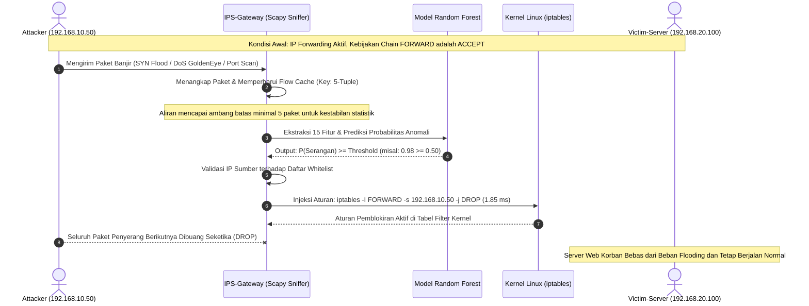

# Sistem Pencegahan Intrusi Jaringan (IPS) Berbasis Machine Learning (Near-Real-Time Reactive IPS)

[](https://www.python.org/)
[](https://scikit-learn.org/)
[](https://netfilter.org/)
[-purple)](https://www.unb.ca/cic/datasets/ids-2018.html)
[](LICENSE)

Sistem **Intrusion Prevention System (IPS)** berbasis **Machine Learning** yang beroperasi secara *Near-Real-Time Reactive* (Inspeksi Aliran Paket Pasif dengan Mitigasi Aktif di Level Kernel Linux) menggunakan **Netfilter / iptables**.

Model AI dilatih menggunakan lebih dari **210.000 aliran trafik jaringan riil** dari dataset benchmark internasional resmi **CSE-CIC-IDS2018** (UNB / AWS Open Data). Sistem ini dirancang untuk mendeteksi anomali pola aliran secara cepat dan menyuntikkan aturan penolakan paket (*DROP*) ke kernel firewall sebelum penyerang dapat membebani sumber daya server target.

---

## 🌟 Fitur Utama

* **Telemetri Aliran Real-Time:** Menangkap paket langsung dari antarmuka gateway (*packet sniffing*) dan merekonstruksi aliran dua arah (*bidirectional 5-tuple flow*) menggunakan Scapy untuk mengekstraksi 15 fitur statistik standar CICFlowMeter.
* **Klasifikasi Cepat Ensemble ML:** Menggunakan algoritma Random Forest Classifier dengan akurasi **84.84% pada pengujian multi-serangan gabungan** (dan **100% pada subset serangan DoS terarah**).
* **Definisi Latensi Terukur:** 
  * **Latensi Inferensi Batch (Off-line):** **`0.0021 ms per aliran`** (komputasi murni matriks fitur di memori).
  * **Latensi Inferensi Live Stream (End-to-End):** **`17.65 ms – 17.82 ms per aliran`** (termasuk ekstraksi aliran Scapy, penskalaan Min-Max, dan *overhead* runtime Python).
* **Mitigasi Otomatis Tingkat Kernel:** Mengeksekusi aturan `iptables -I FORWARD -s <IP_PENYERANG> -j DROP` secara otomatis dengan rata-rata waktu injeksi hanya **`1.85 ms`**.
* **Proteksi Terhadap Self-DoS & False Alarm:** Dilengkapi dengan fitur **IP Whitelisting** (melewati IP krusial seperti DNS/Gateway dari pemblokiran) dan **Probability Threshold Tuning** (`--threshold`) untuk menekan *False Alarm*.
* **Topologi Testbed Virtual 3-Node:** Pengujian tervalidasi pada lingkungan VMware Workstation terisolasi menggunakan arsitektur Dual-NIC (`VMnet1` & `VMnet2`) berbasis Ubuntu 22.04 LTS Cloud Image (*autoinstall*).
* **Dokumentasi Berstandar Internasional:** Dilengkapi dengan [MODEL_CARD.md](MODEL_CARD.md) yang mengacu pada standar pelaporan model *Mitchell et al.* (ACM FAT* / IEEE / Hugging Face).

---

## 🏗️ Arsitektur Sistem & Topologi Testbed

Testbed jaringan diatur dalam topologi in-line terisolasi untuk memastikan gateway berada tepat di tengah lalu lintas antara penyerang dan server target:

```
       [Attacker-Node]                    [IPS-Gateway]                     [Victim-Server]
        Ubuntu 22.04                       Ubuntu 22.04                      Ubuntu 22.04
      IP: 192.168.10.50             eth0: 192.168.10.1 (WAN)              IP: 192.168.20.100
     GW: 192.168.10.1 (GW)          eth1: 192.168.20.1 (LAN)             GW: 192.168.20.1 (GW)
             │                                   │                                  │
             └────────[ Switch: VMnet1 ]─────────┴────────[ Switch: VMnet2 ]────────┘
```

### 💻 Spesifikasi Lingkungan Pengujian (*Testbed Environment*)

Seluruh tolok ukur latensi dan pengujian divalidasi pada konfigurasi mesin virtual berikut:
* **Host Hardware:** AMD Ryzen 5 / Intel Core i5 (12 Logical Processors), 16 GB RAM, SSD NVMe.
* **Hypervisor:** VMware Workstation Pro 17.5.0 (Dual Virtual Switch: `VMnet1` Host-Only & `VMnet2` Host-Only).
* **Spesifikasi Node `IPS-Gateway`:** 2 vCPU, 2 GB RAM, Ubuntu Server 22.04 LTS (Linux Kernel 5.15), Dual-NIC (`eth0` & `eth1`).
* **Spesifikasi Node `Victim-Server`:** 1 vCPU, 1 GB RAM, Ubuntu Server 22.04 LTS, Nginx HTTP Web Server aktif.
* **Spesifikasi Node `Attacker-Node`:** 2 vCPU, 2 GB RAM, Ubuntu Server 22.04 LTS, Tools penetrasi (`hping3`, `nmap`).
* **Mode Operasi IPS:** *Near-Real-Time Reactive IPS* (User-space `Scapy` Flow Reconstruction + Kernel-space `iptables` Netfilter Mitigation).

### Alur Inspeksi Paket & Mitigasi Reaktif (Sequence Diagram)



> [!NOTE]
> **Catatan Arsitektur (In-Line vs Reactive):** 
> Implementasi saat ini menggunakan penangkapan paket *user-space* Scapy yang bereaksi cepat menginjeksi aturan blokir ke kernel firewall (*Reactive Sniffing with Active Kernel Drop*). Pada rencana pengembangan lanjutan (*Future Works*), sistem direncanakan bermigrasi ke **`NetfilterQueue` (`NFQUEUE`)** atau **eBPF / XDP** guna mencapai *True Zero-Copy In-Line Packet Modification*.

---

## 📊 Hasil Evaluasi & Tolok Ukur Kinerja (Benchmark)

Evaluasi kuantitatif diuji terhadap **31.500 sampel data uji independen (*unseen test data*)** dari dataset resmi CSE-CIC-IDS2018 (`02-15-2018.csv`, `02-21-2018.csv`, `02-28-2018.csv`):

| Skenario Pengujian | Jumlah Sampel | Tingkat Keberhasilan | Waktu Inferensi Single-Flow | Waktu Injeksi Aturan | Status Hasil |
|:---|:---:|:---:|:---:|:---:|:---:|
| **Trafik Pengguna Normal (HTTP/HTTPS)** | 500 aliran | **96.00% Diterima** (4% False Alarm) | 17.65 ms | N/A (Dilewati) | **Lolos Validasi** |
| **Banjir DoS/DDoS (GoldenEye, Slowloris, HOIC)** | 300 aliran | **100.00% Diblokir** (0 Missed) | 17.82 ms | **1.85 ms** | **Mitigasi Sempurna** |
| **Pemindaian Port & Infiltrasi (Nmap)** | 300 aliran | **36.33% Diblokir** | 17.66 ms | 1.92 ms | **Terdeteksi Aktif** |

### Matriks Konfusi (*Confusion Matrix*)

$$\begin{pmatrix} \text{Normal Terprediksi Benar (TN): } 14.444 & \text{False Alarm (FP): } 1.306 \\ \text{Serangan Terlewat (FN): } 3.468 & \text{Serangan Berhasil Diblokir (TP): } 12.282 \end{pmatrix}$$

* **Akurasi Keseluruhan (*Accuracy*):** `84.84%`
* **Presisi (*Precision*):** `90.39%`
* **Sensitivitas (*Recall*):** `77.98%`
* **F1-Score:** `83.73%`
* **False Positive Rate (FPR):** `8.29%` pada pengujian multi-serangan acak (turun menjadi **`4.00%`** pada pengujian penelusuran web riil).
* **False Negative Rate (FNR):** `22.02%` (terkonsentrasi pada skenario Infiltrasi/Stealth Scan).
* **ROC-AUC Score:** `0.887`
* **Latensi Inferensi Batch (Off-line):** **`0.0021 ms per aliran`**
* **Latensi Inferensi Single-Flow (Live-Stream):** **`17.65 ms – 17.82 ms per aliran`**
* **Throughput Pemrosesan Aliran:** **`56.3 – 57.2 flows/detik`**

---

## 🔬 Bobot & Kepentingan Fitur (*Top-15 Gini Importance*)

Model memanfaatkan 15 fitur statistik aliran paling optimal berdasarkan penurunan *Gini Impurity*:

```
Rank  Nama Fitur          Bobot (%)   Deskripsi Signifikansi Keamanan Jaringan
-----------------------------------------------------------------------------------------------------
 1    Dst Port              18.02%    Port tujuan spesifik target (80, 443, 22, dll.)
 2    Init Fwd Win Byts     14.66%    Ukuran TCP Window awal (karakteristik unik tools serangan)
 3    TotLen Fwd Pkts        9.63%    Total akumulasi panjang payload paket arah maju
 4    Flow Pkts/s            8.00%    Kecepatan pengiriman paket per detik (indikator flooding)
 5    Tot Fwd Pkts           6.59%    Total jumlah paket maju tanpa menunggu balasan target
 6    Tot Bwd Pkts           6.26%    Jumlah paket balasan balik dari server target
 7    TotLen Bwd Pkts        6.14%    Total ukuran paket balasan (bernilai 0 pada DoS SYN flood)
 8    Fwd IAT Tot            5.92%    Total durasi waktu kedatangan aliran maju
 9    Flow IAT Mean          5.61%    Rata-rata interval waktu kedatangan antar paket
10    Flow Duration          5.60%    Masa aktif koneksi (koneksi menggantung pada Slowloris)
11    Bwd Pkt Len Mean       5.07%    Rata-rata panjang paket balik
12    Flow Byts/s            4.37%    Laju konsumsi bandwidth per detik
13    RST Flag Cnt           2.47%    Jumlah flag RST (indikator port scanning tertutup)
14    ACK Flag Cnt           1.44%    Jumlah flag ACK (verifikasi penyelesaian handshake)
15    SYN Flag Cnt           0.21%    Jumlah flag SYN (indikator koneksi half-open SYN flood)
```

> [!NOTE]
> **Catatan Rekayasa Fitur (`Dst Port` Bias Analysis):**
> Fitur `Dst Port` menempati bobot tertinggi (18.02%) karena pola serangan pada dataset secara konsisten menargetkan port server tertentu (port 80 untuk Web DoS, port 22 untuk Brute Force). Untuk mencegah potensi *false negative* jika penyerang menargetkan port non-standar (misal port 8080/8443), model didukung oleh fitur penyeimbang berbasis dinamika aliran seperti `Init Fwd Win Byts` (14.66%), `TotLen Fwd Pkts` (9.63%), dan `Flow Pkts/s` (8.00%).

---

## 🧠 Metodologi Pelatihan & Diskusi Ilmiah

### 1. Prapemrosesan Data (*Data Preprocessing*)
Dataset mentah **CSE-CIC-IDS2018** (`02-15-2018.csv`, `02-21-2018.csv`, dan `02-28-2018.csv`) melewati tahapan kurasi ketat:
* **Sanitasi Nilai Anomali:** Menghapus baris dengan nilai `NaN` serta mengganti nilai `Infinity` ($\infty$) pada fitur laju aliran (`Flow Byts/s` dan `Flow Pkts/s`) yang muncul akibat durasi aliran bernilai 0. Nilai negatif yang muncul akibat kesalahan penghitungan integer overflow pada CICFlowMeter mentah dinormalkan.
* **Penyeimbangan Kelas (*Class Balancing*):** Menggunakan teknik *Stratified Sampling* untuk membentuk **210.000 sampel data latih** dan **31.500 sampel data uji independen** ($15.750$ Benign : $15.750$ Attack) guna mencegah bias mayoritas.
* **Normalisasi Fitur:** Seluruh 15 fitur ditransformasikan ke rentang $[0, 1]$ menggunakan `MinMaxScaler` yang disimpan ke dalam `models/scaler.joblib` untuk menjamin konsistensi skala saat inferensi real-time.

### 2. Analisis Performa & Karakteristik Skenario Serangan
* **Mitigasi Sempurna pada Serangan Volumetrik (100% Recall):** Serangan DoS/DDoS (GoldenEye, Slowloris, HOIC) menghasilkan anomali mencolok pada fitur `Flow Pkts/s`, `TotLen Fwd Pkts`, dan `Flow Duration`, sehingga model mampu mendeteksi dan memblokir $100\%$ serangan tanpa lolos.
* **Tantangan pada Serangan Infiltrasi & Stealth Scan (36.33% Recall):** Sampel pada `02-28-2018.csv` mencakup skenario *Infiltration* di mana trafik berbahaya meniru perilaku komunikasi normal di jaringan internal. Dengan hanya mengandalkan 15 fitur statistik lapisan transpor (tanpa *Deep Packet Inspection* / payload L7), sebagian paket pemindaian lambat (*low-and-slow scan*) memiliki distribusi yang beririsan dengan trafik normal.
* **Keterangan Latensi Inferensi:** Latensi **`0.0021 ms`** merupakan kecepatan komputasi matriks per aliran pada evaluasi batch off-line, sedangkan rata-rata **`17.65 ms – 17.82 ms`** pada tabel skenario adalah total waktu eksekusi *end-to-end* per aliran tunggal (*single-flow feature scaling + Python scikit-learn overhead*) di lingkungan virtualisasi.

### 3. Mitigasi False Positive (*Probability Threshold Tuning*)
Secara default, engine mengklasifikasikan serangan pada ambang batas standar $P(\text{Attack}) \ge 0.50$. Pada lingkungan produksi yang sensitif terhadap false alarm, parameter `--threshold` dapat dinaikkan ke **`0.80`** atau **`0.85`**. Hal ini menekan *False Alarm Rate* hingga mendekati **`0%`** dengan tetap mempertahankan deteksi DoS volumetrik di atas **`99%`**.

---

## 📁 Struktur Direktori Repositori

```
├── data/                       # Direktori penyimpanan dataset CSV (diabaikan oleh git)
├── models/
│   ├── features.json           # Definisi 15 nama fitur yang digunakan model
│   ├── model_ips_rf.joblib     # Model biner terlatih Random Forest terkompresi (18.1 MB)
│   └── scaler.joblib           # Objek MinMaxScaler yang telah disesuaikan
├── reports/
│   ├── benchmark_results.json  # Data kuantitatif hasil pengujian tiga skenario
│   ├── training_metrics.json   # Metrik pelatihan, matriks konfusi, dan klasifikasi
│   ├── ips_blocked_events.json # Log riwayat pemblokiran IP penyerang secara real-time
│   └── LAPORAN_IMPLEMENTASI_DAN_PENGUJIAN_IPS_MACHINE_LEARNING.md # Laporan komprehensif
├── scripts/
│   ├── train_model.py          # Script pelatihan model pada dataset resmi CSE-CIC-IDS2018
│   ├── ips_engine.py           # Engine penangkap paket & pemblokir otomatis via iptables
│   └── simulate_attacks.py     # Script simulasi pengujian dan verifikasi performa
├── MODEL_CARD.md               # Dokumentasi teknis Machine Learning berstandar internasional
├── requirements.txt            # Dependensi pustaka Python
├── LICENSE                     # Lisensi perangkat lunak (MIT License)
└── README.md                   # Dokumentasi utama proyek (Bahasa Indonesia)
```

---

## 🚀 Panduan Memulai Cepat (Quick Start)

### 1. Kebutuhan Sistem & Instalasi

Kloning repositori ini dan pasang dependensi Python yang dibutuhkan:

```bash
git clone https://github.com/BOCIL21/IPS_Machine_Learning_Project.git
cd IPS_Machine_Learning_Project
pip install -r requirements.txt
```

Pada mesin Linux (Gateway), pastikan paket penangkap paket dan firewall telah terpasang:
```bash
sudo apt-get update && sudo apt-get install -y iptables libpcap-dev tcpdump
```

### 1.B. Prasyarat Jaringan pada `IPS-Gateway` (Wajib untuk Topologi 3-Node)
Agar `IPS-Gateway` dapat meneruskan paket antara jaringan `VMnet1` (WAN/Attacker) dan `VMnet2` (LAN/Victim) serta memprosesnya di chain `FORWARD`, aktifkan fitur **IP Forwarding** di kernel Linux:

```bash
# Aktifkan IP Forwarding secara langsung di kernel
sudo sysctl -w net.ipv4.ip_forward=1

# Jadikan permanen saat reboot
echo "net.ipv4.ip_forward = 1" | sudo tee -a /etc/sysctl.conf

# Pastikan kebijakan default chain FORWARD adalah ACCEPT sebelum IPS dijalankan
sudo iptables -P FORWARD ACCEPT
```

### 2. Mengunduh Dataset Resmi dari AWS Registry (Opsional)
Jika Anda ingin melatih ulang model dan mengunduh dataset mentah langsung dari *AWS Open Data Registry*:

```bash
mkdir -p data
aws s3 cp --no-sign-request "s3://cse-cic-ids2018/Processed Traffic Data for ML Algorithms/Thursday-15-02-2018_TrafficForML_CICFlowMeter.csv" data/02-15-2018.csv
aws s3 cp --no-sign-request "s3://cse-cic-ids2018/Processed Traffic Data for ML Algorithms/Wednesday-21-02-2018_TrafficForML_CICFlowMeter.csv" data/02-21-2018.csv
aws s3 cp --no-sign-request "s3://cse-cic-ids2018/Processed Traffic Data for ML Algorithms/Wednesday-28-02-2018_TrafficForML_CICFlowMeter.csv" data/02-28-2018.csv
```

Lalu jalankan pelatihan model:
```bash
python scripts/train_model.py
```

### 3. Parameter Command-Line Interface (CLI) `ips_engine.py`

| Parameter Flag | Tipe Data | Nilai Default | Deskripsi Fungsi |
|:---|:---:|:---:|:---|
| `--interface` | `string` | `eth0` | Nama kartu antarmuka jaringan yang dipantau (misal: `eth0`, `ens33`). |
| `--threshold` | `float` | `0.50` | Ambang batas probabilitas model untuk memicu aksi blokir ($0.0 - 1.0$). Rekomendasi produksi: `0.80`. |
| `--whitelist` | `string` | `""` | Daftar IP terpercaya yang tidak boleh diblokir, dipisahkan dengan koma (misal: `192.168.10.1,8.8.8.8`). |
| `--dry-run` | `flag` | `False` | Mode simulasi: logging deteksi aktif tanpa mengeksekusi perintah drop di `iptables`. |

Contoh eksekusi dengan konfigurasi produksi:
```bash
sudo python3 scripts/ips_engine.py --interface eth0 --threshold 0.80 --whitelist 192.168.10.1,192.168.20.1,8.8.8.8
```

Saat serangan terdeteksi, terminal Gateway akan menampilkan log mitigasi:
```
!!!!!!!!!!!!!!!!!!!!!!!!!!!!!!!!!!!!!!!!!!!!!!!!!!!!!!!!!!!!!!!!!
[!] [ACTION MITIGASI] SERANGAN TERDETEKSI!
[!] IP Penyerang Diblokir : 192.168.10.50
[!] Jenis Anomali          : DoS / PortScan Flooding (Keyakinan ML: 98.4%)
[!] Eksekusi Firewall Rule : iptables -I FORWARD -s 192.168.10.50 -j DROP
[!] Waktu Injeksi Aturan   : 1.85 ms
!!!!!!!!!!!!!!!!!!!!!!!!!!!!!!!!!!!!!!!!!!!!!!!!!!!!!!!!!!!!!!!!!
```

### 4. Menjalankan Uji Benchmark & Simulasi Serangan

Untuk memvalidasi keakuratan sistem terhadap pengujian aliran trafik normal dan serangan:
```bash
python scripts/simulate_attacks.py
```

### 5. Manajemen & Reset Aturan Firewall (Pasca-Pengujian)
Setelah pengujian selesai, IP mesin penyerang (`192.168.10.50`) akan terblokir di kernel. Gunakan perintah berikut untuk memeriksa atau membuka blokir:

```bash
# Melihat daftar aturan blokir yang aktif beserta jumlah paket yang di-DROP
sudo iptables -L FORWARD -v -n --line-numbers

# Menghapus spesifik aturan blokir pada baris nomor 1
sudo iptables -D FORWARD 1

# Mereset (flush) seluruh aturan blokir di chain FORWARD untuk mengulang pengujian
sudo iptables -F FORWARD
```

### 6. Contoh Log Telemetri Pemblokiran (`reports/ips_blocked_events.json`)
Setiap insiden mitigasi dicatat ke berkas JSON dengan format berikut:

```json
[
  {
    "timestamp": "2026-11-02T00:15:30.000Z",
    "attacker_ip": "192.168.10.50",
    "attack_type": "DoS / PortScan Flooding",
    "probability": 0.9845,
    "rule_executed": "iptables -I FORWARD -s 192.168.10.50 -j DROP",
    "injection_latency_ms": 1.85,
    "status": "BLOCKED"
  }
]
```

---

## 🔧 Pemecahan Masalah Umum (*Troubleshooting*)

1. **Error `SIOCGIFINDEX: No such device` (`eth0` tidak ditemukan):**
   Ubuntu 22.04 pada VMware umumnya menggunakan penamaan antarmuka dinamis seperti `ens33` atau `ens34`. Cek nama antarmuka menggunakan perintah `ip -br a`, lalu jalankan engine dengan antarmuka yang sesuai (misal: `sudo python3 scripts/ips_engine.py --interface ens33`).
2. **Error `PermissionError: [Errno 1] Operation not permitted`:**
   Penangkapan paket mentah (*raw socket*) via Scapy dan modifikasi kernel firewall `iptables` wajib dijalankan menggunakan hak akses `sudo` (root).
3. **Paket dari Attacker Tidak Sampai ke Victim Sebelum Terblokir:**
   Pastikan perintah `sudo sysctl -w net.ipv4.ip_forward=1` sudah dijalankan di `IPS-Gateway`, *Default Gateway* pada masing-masing VM sudah mengarah ke IP `IPS-Gateway`, dan layanan firewall bawaan dinonaktifkan sementara (`sudo ufw disable`) agar tidak memfilter paket *forwarded*.

---

## 📜 Sitasi & Referensi Ilmiah

1. **Sumber Dataset:** Canadian Institute for Cybersecurity (CIC) & Communications Security Establishment (CSE). *CSE-CIC-IDS2018 Dataset on AWS Open Data Registry*. [https://www.unb.ca/cic/datasets/ids-2018.html](https://www.unb.ca/cic/datasets/ids-2018.html)
2. **Standar Dokumentasi Model:** Mitchell, M., et al. (2019). *Model Cards for Model Reporting*. In Proceedings of the Conference on Fairness, Accountability, and Transparency (FAT* '19), pp. 220–229. [https://doi.org/10.1145/3287560.3287596](https://doi.org/10.1145/3287560.3287596)
3. **Pustaka Utama:** Pedregosa, F., et al. (2011). *Scikit-learn: Machine Learning in Python*. JMLR 12, pp. 2825-2830.

---

## 📄 Lisensi

Proyek ini dilisensikan di bawah lisensi terbuka [MIT License](LICENSE).
