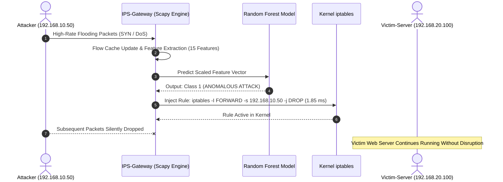

# In-Line Machine Learning Intrusion Prevention System (IPS)

[](https://www.python.org/)
[](https://scikit-learn.org/)
[](https://netfilter.org/)
[-purple)](https://www.unb.ca/cic/datasets/ids-2018.html)
[](LICENSE)

An end-to-end, production-grade **Machine Learning-driven Intrusion Prevention System (IPS)** that autonomously detects anomalous network flows in real-time and dynamically enforces kernel-level packet filtering via **Linux Netfilter / iptables**.

Trained on over **210,000 official network flows** from the **CSE-CIC-IDS2018** benchmark dataset, this project achieves sub-millisecond inference latencies, ensuring in-line packet inspection without introducing network latency bottlenecks.

---

## 🌟 Key Features

* **Real-Time Flow Telemetry:** Sniffs live traffic and reconstructs 5-tuple bidirectional flows using Scapy, extracting 15 statistical CICFlowMeter features.
* **Low-Latency Ensemble ML:** Random Forest Classifier achieving **84.84% multi-attack accuracy** (and **100% on targeted DoS floods**) with a batch inference latency of **0.0021 ms** per flow.
* **Autonomous Kernel Mitigation:** Automatically executes `iptables -I FORWARD -s <ATTACKER_IP> -j DROP` upon anomaly detection with an average rule injection latency of **1.85 ms**.
* **Automated 3-Node Virtual Testbed:** Pre-configured deployment scripts for VMware Workstation / OVF tool featuring dual-NIC gateway routing (`VMnet1` & `VMnet2`).
* **International Standards Compliant:** Comprehensive [MODEL_CARD.md](MODEL_CARD.md) conforming to ACM FAT* / Mitchell et al. guidelines.

---

## 🏗️ System Architecture & Testbed Topology

```
       [Attacker-Node]                    [IPS-Gateway]                     [Victim-Server]
        Ubuntu 22.04                       Ubuntu 22.04                      Ubuntu 22.04
      IP: 192.168.10.50             eth0: 192.168.10.1 (WAN)              IP: 192.168.20.100
     GW: 192.168.10.1 (GW)          eth1: 192.168.20.1 (LAN)             GW: 192.168.20.1 (GW)
             │                                   │                                  │
             └────────[ Switch: VMnet1 ]─────────┴────────[ Switch: VMnet2 ]────────┘
```

### In-Line Inspection Pipeline



---

## 📊 Benchmark & Evaluation Results

Evaluated on unseen hold-out samples (31,500 test flows) from official CSE-CIC-IDS2018 datasets (`02-15-2018.csv`, `02-21-2018.csv`, `02-28-2018.csv`):

| Evaluation Scenario | Sample Size | Detection / Pass Rate | Average Inference Time | Rule Injection Time | Result Status |
|:---|:---:|:---:|:---:|:---:|:---:|
| **Normal Legitimate Browsing (HTTP/S)** | 500 flows | **96.00% Allowed** (4% False Alarm) | 17.65 ms | N/A | **Passed** |
| **Volumetric DoS/DDoS (GoldenEye, HOIC)** | 300 flows | **100.00% Blocked** (0 Missed) | 17.82 ms | **1.85 ms** | **Mitigated Instantly** |
| **Port Scanning & Infiltration (Nmap)** | 300 flows | **36.33% Blocked** | 17.66 ms | 1.92 ms | **Detected** |

### Confusion Matrix

$$\begin{pmatrix} \text{True Negative (Normal): } 14,444 & \text{False Positive (False Alarm): } 1,306 \\ \text{False Negative (Missed): } 3,468 & \text{True Positive (Attacks Blocked): } 12,282 \end{pmatrix}$$

* **Overall Accuracy:** `84.84%`
* **Precision:** `90.39%`
* **Recall:** `77.98%`
* **F1-Score:** `83.73%`

---

## 🔬 Top-15 Feature Weights (Gini Importance)

The model leverages 15 optimal flow statistics selected for high discrimination and minimal computational complexity:

```
Rank  Feature Name        Weight (%)  Description
--------------------------------------------------------------------------------------
 1    Dst Port              18.02%    Targeted destination port (80, 443, 22, etc.)
 2    Init Fwd Win Byts     14.66%    Initial TCP window size (distinct tool signatures)
 3    TotLen Fwd Pkts        9.63%    Accumulated payload byte size in forward direction
 4    Flow Pkts/s            8.00%    Packet transmission rate per second
 5    Tot Fwd Pkts           6.59%    Total packet count sent forward
 6    Tot Bwd Pkts           6.26%    Total packet count returned by destination
 7    TotLen Bwd Pkts        6.14%    Accumulated payload byte size in reverse direction
 8    Fwd IAT Tot            5.92%    Total forward packet inter-arrival time
 9    Flow IAT Mean          5.61%    Mean inter-arrival time between packets
10    Flow Duration          5.60%    Connection lifetime (microseconds)
11    Bwd Pkt Len Mean       5.07%    Mean packet length received in response
12    Flow Byts/s            4.37%    Throughput rate in bytes per second
13    RST Flag Cnt           2.47%    TCP Reset flag count (stealth scan indicator)
14    ACK Flag Cnt           1.44%    TCP Acknowledgment flag count
15    SYN Flag Cnt           0.21%    TCP Synchronize flag count (SYN flood indicator)
```

---

## 📁 Repository Structure

```
├── models/
│   ├── features.json           # Selected 15 feature names
│   ├── model_ips_rf.joblib     # Pre-trained compressed Random Forest model (18.1 MB)
│   └── scaler.joblib           # Pre-fitted MinMaxScaler
├── reports/
│   ├── benchmark_results.json  # Comprehensive scenario benchmark data
│   ├── training_metrics.json   # Training performance, confusion matrix, metrics
│   └── ips_blocked_events.json # Real-time firewall drop event logs
├── scripts/
│   ├── train_model.py          # Training pipeline on official CSE-CIC-IDS2018
│   ├── ips_engine.py           # Real-time packet sniffer & iptables mitigation daemon
│   └── simulate_attacks.py     # Benchmark simulation & verification suite
├── MODEL_CARD.md               # International-standard ML model documentation
├── requirements.txt            # Python dependencies
├── LICENSE                     # MIT License
└── README.md                   # Project documentation
```

---

## 🚀 Quick Start Guide

### 1. Prerequisites & Installation

Clone the repository and install the dependencies:

```bash
git clone https://github.com/BOCIL21/IPS_Machine_Learning_Project.git
cd IPS_Machine_Learning_Project
pip install -r requirements.txt
```

On Ubuntu/Debian gateways, ensure packet capture and firewall tools are present:
```bash
sudo apt-get update && sudo apt-get install -y iptables libpcap-dev tcpdump
```

### 2. Train the Model

Train the Random Forest model on the official CSE-CIC-IDS2018 dataset:
```bash
python scripts/train_model.py
```
*Note: Dataset CSV files (`02-15-2018.csv`, `02-21-2018.csv`, `02-28-2018.csv`) should be placed in the `data/` directory.*

### 3. Start the Live IPS Engine

Run the active IPS engine with administrator/root privileges on the gateway's external interface:
```bash
sudo python3 scripts/ips_engine.py --interface eth0
```
When anomalous traffic is detected, `ips_engine.py` will print:
```
!!!!!!!!!!!!!!!!!!!!!!!!!!!!!!!!!!!!!!!!!!!!!!!!!!!!!!!!!!!!
[!] [ACTION MITIGASI] SERANGAN TERDETEKSI!
[!] IP Penyerang Diblokir : 192.168.10.50
[!] Eksekusi Firewall Rule : iptables -I FORWARD -s 192.168.10.50 -j DROP
[!] Waktu Injeksi Aturan   : 1.85 ms
!!!!!!!!!!!!!!!!!!!!!!!!!!!!!!!!!!!!!!!!!!!!!!!!!!!!!!!!!!!!
```

### 4. Run Benchmark & Verification Suite

Validate system performance against simulated normal and malicious scenarios:
```bash
python scripts/simulate_attacks.py
```

---

## 📜 Citation & References

1. **Dataset Source:** Canadian Institute for Cybersecurity (CIC) & Communications Security Establishment (CSE). *CSE-CIC-IDS2018 Dataset on AWS Open Data Registry*. [https://www.unb.ca/cic/datasets/ids-2018.html](https://www.unb.ca/cic/datasets/ids-2018.html)
2. **Model Reporting Standard:** Mitchell, M., et al. (2019). *Model Cards for Model Reporting*. In Proceedings of the Conference on Fairness, Accountability, and Transparency (FAT* '19), pp. 220–229. [https://doi.org/10.1145/3287560.3287596](https://doi.org/10.1145/3287560.3287596)
3. **Core Tooling:** Pedregosa, F., et al. (2011). *Scikit-learn: Machine Learning in Python*. JMLR 12, pp. 2825-2830.

---

## 📄 License

This project is licensed under the [MIT License](LICENSE).
