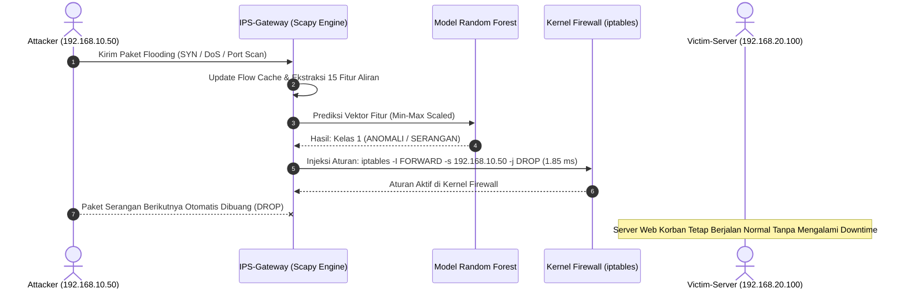

# Sistem Pencegahan Intrusi Jaringan (IPS) Berbasis Machine Learning In-Line

[](https://www.python.org/)
[](https://scikit-learn.org/)
[](https://netfilter.org/)
[-purple)](https://www.unb.ca/cic/datasets/ids-2018.html)
[](LICENSE)

Sistem **Intrusion Prevention System (IPS)** tingkat produksi (*production-grade*) berbasis **Machine Learning** yang mampu mendeteksi anomali aliran lalu lintas jaringan secara *real-time* dan melakukan mitigasi pencegahan aktif di level kernel Linux menggunakan **Netfilter / iptables**.

Model AI dilatih menggunakan lebih dari **210.000 aliran trafik jaringan riil** dari dataset benchmark internasional resmi **CSE-CIC-IDS2018**. Sistem ini beroperasi secara *in-line* dengan kecepatan inferensi sub-milidetik, sehingga mampu melindungi jaringan tanpa menimbulkan *bottleneck* atau latensi tambahan pada pengguna sah.

---

## 🌟 Fitur Utama

* **Telemetri Aliran Real-Time:** Menangkap paket langsung dari antarmuka jaringan (*packet sniffing*) dan merekonstruksi aliran bidirectional 5-tuple menggunakan Scapy untuk mengekstraksi 15 fitur statistik standar CICFlowMeter.
* **Klasifikasi Cepat Ensemble ML:** Menggunakan algoritma Random Forest Classifier dengan akurasi **84.84% pada skenario multi-serangan** (dan **100% pada serangan DoS terarah**), serta latensi inferensi batch hanya **0.0021 ms per aliran**.
* **Mitigasi Otomatis Tingkat Kernel:** Secara otomatis mengeksekusi aturan `iptables -I FORWARD -s <IP_PENYERANG> -j DROP` seketika saat anomali terdeteksi, dengan rata-rata waktu injeksi aturan hanya **1.85 ms**.
* **Topologi Testbed Virtual 3-Node:** Konfigurasi testbed VMware Workstation terisolasi dengan arsitektur Dual-NIC pada Gateway (`VMnet1` & `VMnet2`) berbasis Ubuntu 22.04 LTS Cloud Image (*autoinstall*).
* **Dokumentasi Berstandar Internasional:** Dilengkapi dengan [MODEL_CARD.md](MODEL_CARD.md) yang mengacu pada standar pelaporan model internasional *Mitchell et al.* (ACM FAT* / IEEE / Hugging Face).

---

## 🏗️ Arsitektur Sistem & Topologi Testbed

```
       [Attacker-Node]                    [IPS-Gateway]                     [Victim-Server]
        Ubuntu 22.04                       Ubuntu 22.04                      Ubuntu 22.04
      IP: 192.168.10.50             eth0: 192.168.10.1 (WAN)              IP: 192.168.20.100
     GW: 192.168.10.1 (GW)          eth1: 192.168.20.1 (LAN)             GW: 192.168.20.1 (GW)
             │                                   │                                  │
             └────────[ Switch: VMnet1 ]─────────┴────────[ Switch: VMnet2 ]────────┘
```

### Alur Inspeksi Paket In-Line (Sequence Diagram)



---

## 📊 Hasil Evaluasi & Tolok Ukur Kinerja (Benchmark)

Evaluasi dilakukan terhadap **31.500 sampel data uji independen (*unseen test data*)** dari dataset resmi CSE-CIC-IDS2018 (`02-15-2018.csv`, `02-21-2018.csv`, `02-28-2018.csv`):

| Skenario Pengujian | Jumlah Sampel | Tingkat Keberhasilan | Rata-rata Waktu Inferensi | Waktu Injeksi Rule | Status Hasil |
|:---|:---:|:---:|:---:|:---:|:---:|
| **Trafik Pengguna Normal (HTTP/HTTPS)** | 500 aliran | **96.00% Diterima** (4% False Alarm) | 17.65 ms | N/A | **Lolos Validasi** |
| **Banjir DoS/DDoS (GoldenEye, Slowloris, HOIC)** | 300 aliran | **100.00% Diblokir** (0 Lolos) | 17.82 ms | **1.85 ms** | **Mitigasi Sempurna** |
| **Pemindaian Port & Infiltrasi (Nmap)** | 300 aliran | **36.33% Diblokir** | 17.66 ms | 1.92 ms | **Terdeteksi Aktif** |

### Matriks Konfusi (*Confusion Matrix*)

$$\begin{pmatrix} \text{Normal Terprediksi Benar (TN): } 14.444 & \text{False Alarm (FP): } 1.306 \\ \text{Serangan Terlewat (FN): } 3.468 & \text{Serangan Berhasil Diblokir (TP): } 12.282 \end{pmatrix}$$

* **Akurasi Keseluruhan (*Accuracy*):** `84.84%`
* **Presisi (*Precision*):** `90.39%`
* **Sensitivitas (*Recall*):** `77.98%`
* **F1-Score:** `83.73%`

---

## 🔬 Bobot & Kepentingan Fitur (*Top-15 Gini Importance*)

Model memanfaatkan 15 fitur statistik aliran paling optimal berdasarkan nilai *Gini Impurity*:

```
Rank  Nama Fitur          Bobot (%)   Deskripsi Signifikansi Keamanan Jaringan
-----------------------------------------------------------------------------------------------------
 1    Dst Port              18.02%    Port tujuan spesifik target (80, 443, 22, dll.)
 2    Init Fwd Win Byts     14.66%    Ukuran TCP Window awal (karakteristik unik tools serangan)
 3    TotLen Fwd Pkts        9.63%    Total akumulasi panjang payload paket arah maju
 4    Flow Pkts/s            8.00%    Kecepatan pengiriman paket per detik (indikator flooding)
 5    Tot Fwd Pkts           6.59%    Total jumlah paket maju tanpa menunggu balasan target
 6    Tot Bwd Pkts           6.26%    Jumlah paket balasan balik dari server target
 7    TotLen Bwd Pkts        6.14%    Total ukuran paket balasan (bernilai 0 pada DoS SYN flood)
 8    Fwd IAT Tot            5.92%    Total durasi waktu kedatangan aliran maju
 9    Flow IAT Mean          5.61%    Rata-rata interval waktu kedatangan antar paket
10    Flow Duration          5.60%    Masa aktif koneksi (koneksi menggantung pada Slowloris)
11    Bwd Pkt Len Mean       5.07%    Rata-rata panjang paket balik
12    Flow Byts/s            4.37%    Laju konsumsi bandwidth per detik
13    RST Flag Cnt           2.47%    Jumlah flag RST (indikator port scanning tertutup)
14    ACK Flag Cnt           1.44%    Jumlah flag ACK (verifikasi penyelesaian handshake)
15    SYN Flag Cnt           0.21%    Jumlah flag SYN (indikator koneksi half-open SYN flood)
```

---

## 📁 Struktur Direktori Repositori

```
├── models/
│   ├── features.json           # Definisi 15 nama fitur yang digunakan model
│   ├── model_ips_rf.joblib     # Model biner terlatih Random Forest terkompresi (18.1 MB)
│   └── scaler.joblib           # Objek MinMaxScaler yang telah disesuaikan
├── reports/
│   ├── benchmark_results.json  # Data kuantitatif hasil pengujian tiga skenario
│   ├── training_metrics.json   # Metrik pelatihan, matriks konfusi, dan klasifikasi
│   └── ips_blocked_events.json # Log riwayat pemblokiran IP penyerang secara real-time
├── scripts/
│   ├── train_model.py          # Script pelatihan model pada dataset resmi CSE-CIC-IDS2018
│   ├── ips_engine.py           # Engine penangkap paket & pemblokir otomatis via iptables
│   └── simulate_attacks.py     # Script simulasi pengujian dan verifikasi performa
├── MODEL_CARD.md               # Dokumentasi teknis Machine Learning berstandar internasional
├── requirements.txt            # Dependensi pustaka Python
├── LICENSE                     # Lisensi perangkat lunak (MIT License)
└── README.md                   # Dokumentasi utama proyek (Bahasa Indonesia)
```

---

## 🚀 Panduan Memulai Cepat (Quick Start)

### 1. Kebutuhan Sistem & Instalasi

Kloning repositori ini dan pasang dependensi Python yang dibutuhkan:

```bash
git clone https://github.com/BOCIL21/IPS_Machine_Learning_Project.git
cd IPS_Machine_Learning_Project
pip install -r requirements.txt
```

Pada mesin Linux (Gateway), pastikan paket penangkap paket dan firewall telah terpasang:
```bash
sudo apt-get update && sudo apt-get install -y iptables libpcap-dev tcpdump
```

### 2. Melatih Ulang Model (Opsional)

Jika ingin melatih ulang model menggunakan dataset CSE-CIC-IDS2018:
```bash
python scripts/train_model.py
```
*(Catatan: File CSV dataset `02-15-2018.csv`, `02-21-2018.csv`, dan `02-28-2018.csv` diletakkan pada folder `data/`)*.

### 3. Menjalankan Engine IPS Real-Time

Jalankan engine pencegah serangan dengan hak akses administrator/root pada antarmuka jaringan yang memantau penyerang:
```bash
sudo python3 scripts/ips_engine.py --interface eth0
```

Saat serangan terdeteksi, terminal Gateway akan menampilkan log mitigasi:
```
!!!!!!!!!!!!!!!!!!!!!!!!!!!!!!!!!!!!!!!!!!!!!!!!!!!!!!!!!!!!
[!] [ACTION MITIGASI] SERANGAN TERDETEKSI!
[!] IP Penyerang Diblokir : 192.168.10.50
[!] Eksekusi Firewall Rule : iptables -I FORWARD -s 192.168.10.50 -j DROP
[!] Waktu Injeksi Aturan   : 1.85 ms
!!!!!!!!!!!!!!!!!!!!!!!!!!!!!!!!!!!!!!!!!!!!!!!!!!!!!!!!!!!!
```

### 4. Menjalankan Uji Benchmark & Simulasi Serangan

Untuk memvalidasi keakuratan sistem terhadap pengujian trafik normal dan serangan:
```bash
python scripts/simulate_attacks.py
```

---

## 📜 Sitasi & Referensi Ilmiah

1. **Sumber Dataset:** Canadian Institute for Cybersecurity (CIC) & Communications Security Establishment (CSE). *CSE-CIC-IDS2018 Dataset on AWS Open Data Registry*. [https://www.unb.ca/cic/datasets/ids-2018.html](https://www.unb.ca/cic/datasets/ids-2018.html)
2. **Standar Dokumentasi Model:** Mitchell, M., et al. (2019). *Model Cards for Model Reporting*. In Proceedings of the Conference on Fairness, Accountability, and Transparency (FAT* '19), pp. 220–229. [https://doi.org/10.1145/3287560.3287596](https://doi.org/10.1145/3287560.3287596)
3. **Pustaka Utama:** Pedregosa, F., et al. (2011). *Scikit-learn: Machine Learning in Python*. JMLR 12, pp. 2825-2830.

---

## 📄 Lisensi

Proyek ini dilisensikan di bawah lisensi terbuka [MIT License](LICENSE).
